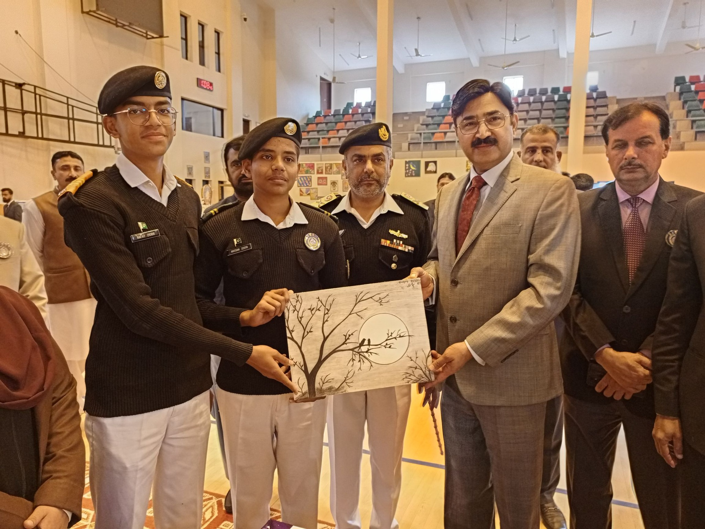
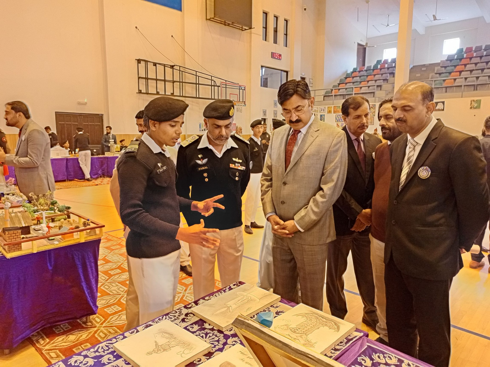

# Hassan Uddin Qureshi — Portfolio
**Aspiring Computer Science & Artificial Intelligence Undergraduate (2027 Entry)**  
*Cadet College Petaro | Tech Innovator, National Merit Scholar & Visual Artist*

---

##  Welcome to My Portfolio
This repository serves as a centralized archive showcasing the intersection of my technical tracks in **Data Analytics & AI**, my continuous algorithmic training, and my leadership execution as a student leader and visual artist.

---

## Fine Arts & Leadership Portfolio
### Role: President of the College Sketching Club (Cadet College Petaro)
In my role as President, I lead fine arts engagement within a highly disciplined military boarding environment. My personal work specializes in **graphite pencil shading, structural/mechanical layout precision, and anatomical surrealism**. 

Below is the verified evidence of my artwork being officially curated and presented to dignitaries during the college's grand institutional exhibition:

####  Exhibition & Club Leadership Highlights

  
  

* **Left:** Presenting our custom club landscape work to the institutional chief guest alongside executive board members.
* **Right:** Elaborating on shading dynamics, spatial geometry, and perspective design layouts during the annual showcase evaluation.

####  Featured Artwork Studies
* **Anatomical Surrealism Study:** A highly detailed graphite pencils study exploring structural proportions blended with natural elements. (Refer to `anatomical-heart-floral-study.jpg`)
* **The Cruise Ship Layout:** An exercise in precise mechanical perspective drawing, highlighting lighting variations and depth scaling. (Refer to `cruise-ship-study.jpeg`)

---

##  Tech Stack & Algorithmic Problem Solving
Apart from my leadership in arts, I am actively building a competitive technical profile for undergraduate Computer Science and AI spaces:

* **Core Skills:** Algorithmic Thinking, Logical Reasoning, Foundations of Python & C.
* **Specialized Training:** Graduate of the *Data Analytics & Business Intelligence* track via DigiSkills (Ignite / Ministry of IT & Telecom).
* **In-Progress Focus:** Applied AI Foundations using Python, Cloud Computing Frameworks, and Web Infrastructure.
* **Competitive Profiles:** Actively sharpening data structure logic on [Codeforces](https://codeforces.com) and [LeetCode](https://leetcode.com).

---

## 🏆 National Academic & Leadership Honors
* **6th Position Nationwide** – National Mathlete Contest (N-CATS)
* **8th Position Nationwide** – National Sciencetien Contest (N-CATS)
* **College High Achiever Award** – Issued on August 14, 2026, for straight **AAA** grades in Cambridge AS-Levels (Math, Physics, CS).
* **College Band Commander** – Appointed Senior Cadet Officer on Sept 6, 2026, leading musical parade formations.

---
*Contact: hassan22218 [at] gmail [dot] com | Verified via Common App ID Portal*
